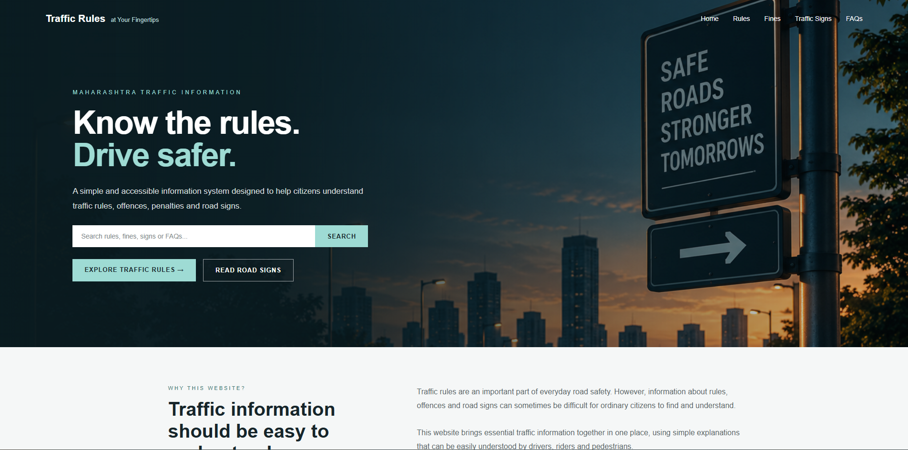
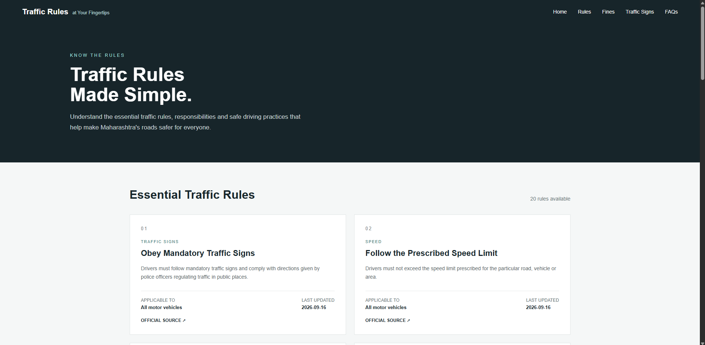
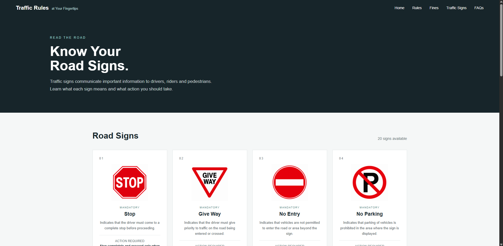
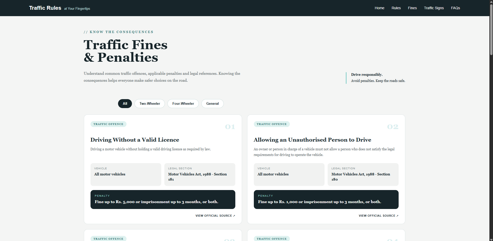
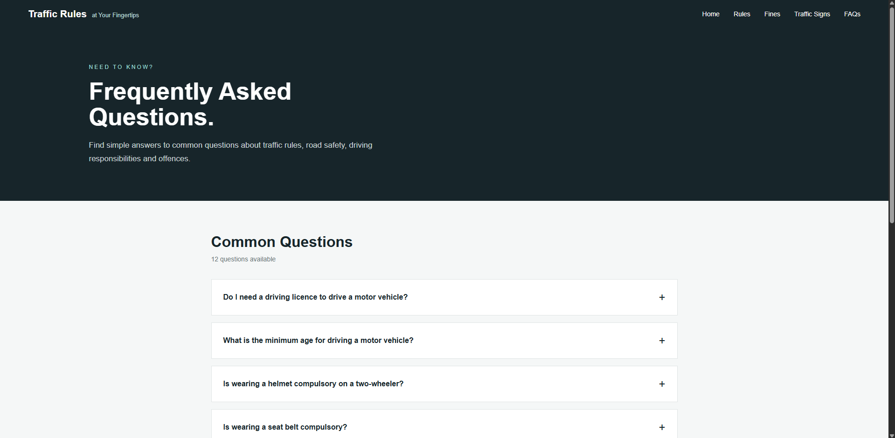
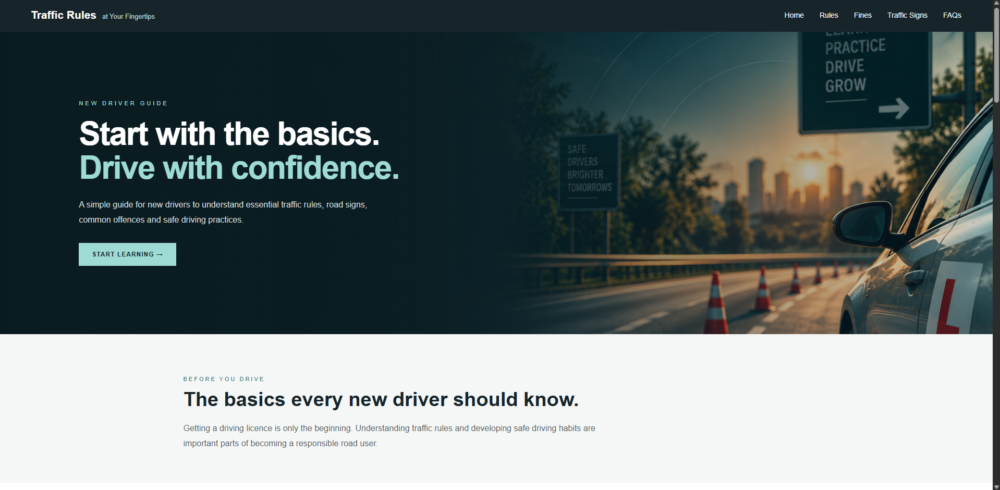
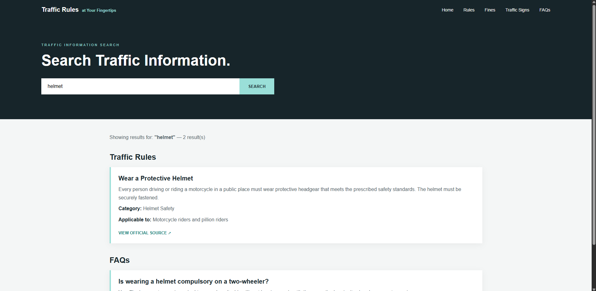

# Traffic Rules at Your Fingertips 🚦

## About the Project

Traffic Rules at Your Fingertips is a web-based application developed to provide users with easy access to information about Maharashtra traffic rules, road signs, traffic violations and their corresponding penalties.

The project aims to spread awareness about road safety and help users understand traffic regulations through an accessible and user-friendly platform.

## Problem Statement

Many people are unaware of traffic regulations, road signs and penalties associated with traffic violations. This lack of awareness can contribute to unsafe driving practices and traffic-related offences.

This project addresses the issue by providing traffic-related information in one convenient online platform.

## Objectives

- To provide information about Maharashtra traffic rules and regulations.
- To educate users about road signs and their meanings.
- To display traffic violations and their corresponding penalties.
- To promote road safety and responsible driving.
- To make traffic-related information easily accessible.

## Technologies Used

- **Frontend:** HTML, CSS, JavaScript
- **Backend:** PHP
- **Database:** MySQL
- **Development Environment:** XAMPP

## Key Features

- Information about Maharashtra traffic rules.
- Details about traffic violations and penalties.
- Road signs and their meanings.
- User-friendly website interface.
- Centralised access to traffic-related information.

## ## Website Screenshots

### Homepage


### Traffic Rules


### Road Signs


### Traffic Fines


### FAQ


### New Drivers Guide



### Search


## Project Structure

```text
Traffic-Rules-at-Your-Fingertips/
│
├── admin/
├── css/
├── js/
├── images/
├── database/
│   └── traffic_rules.sql
│
├── index.php
└── README.md
```

*Note: The project structure above is illustrative. Update it to match the actual folders and files in your repository.*

## Installation and Setup

1. Install XAMPP on your computer.
2. Clone or download this repository.
3. Place the project folder inside the `htdocs` directory of XAMPP.
4. Start Apache and MySQL from the XAMPP Control Panel.
5. Open phpMyAdmin.
6. Create a MySQL database using the database name specified in the project configuration.
7. Import the SQL file available in the `database` folder.
8. Configure the database connection in the PHP configuration file.
9. Open your browser and visit:

```text
http://localhost/YourProjectFolder/
```

## Future Enhancements

- Add more interactive road safety resources.
- Improve accessibility and responsiveness.
- Expand information about traffic regulations.
- Introduce additional user-oriented features.

## Project Type

Academic Project – Field Project

## Author

Abirekha
